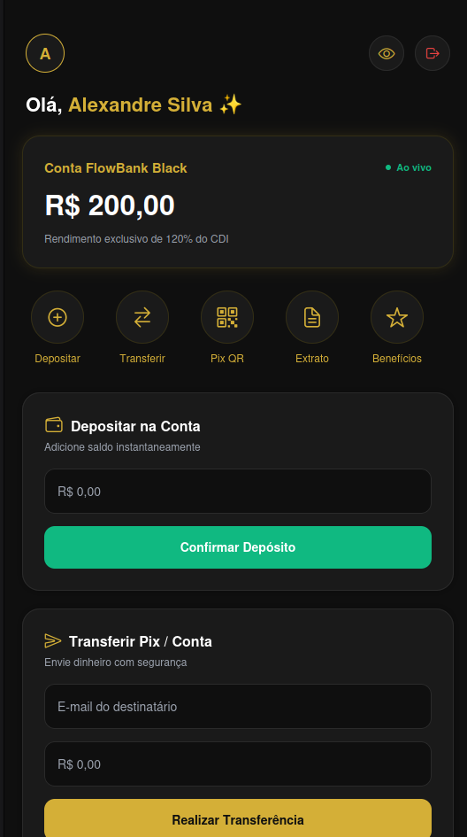

# 🏦 FlowBank Black — Banco Digital VIP

> Uma aplicação bancária full-stack de alto nível com design moderno **Black & Gold VIP**

---

##  Demonstração do Sistema




---

##  Recursos do Sistema

*  **Autenticação Segura**: Cadastro e Login de usuários com tratamento completo de erros visuais em tempo real (ex: e-mail duplicado, credenciais incorretas).
*  **Saldo Ao Vivo (Real-Time)**: Atualização instantânea do saldo bancário através de WebSockets (**Socket.io**).
*  **Área Pix & QR Code**:
  * Gerador de QR Code personalizado para cobrança.
  * Leitor e processador de código Pix com resumo e confirmação antes do envio.
  * Bloqueio inteligente contra auto-transferências.
 *  **Extrato com Comprovante VIP**:
  * Histórico de depósitos e transferências.
  * Visualização de comprovante estilo recibo com ID de autenticação único.
  * Opção de compartilhamento de comprovante via texto/redes sociais.

---

##  Tecnologias Utilizadas

### **Front-end (Mobile & Web)**
* **Expo** (SDK 51+) / **React Native**
* **TypeScript**
* **Socket.io-client** (Comunicação em tempo real)
* **Axios** (Integração com API REST)
* **@expo/vector-icons** & **react-native-qrcode-svg**

### **Back-end**
* **Node.js** com **Express**
* **MongoDB** (Mongoose)
* **Socket.io** (Servidor WebSocket)
* **JWT (JSON Web Token)** & **Bcrypt** (Autenticação e Criptografia)

---

##  Como Executar o Projeto Localmente

### Pré-requisitos
* **Node.js** (v18 ou superior)
* **npm** ou **yarn**
* Instância do **MongoDB** rodando (local ou MongoDB Atlas)

---

### Clonar o Repositório
```bash
git clone [https://github.com/Alexandre-Paulo-Silva/flowbank.git](https://github.com/Alexandre-Paulo-Silva/flowbank.git)
cd flowbank

 Configurar e Rodar o Back-end

    Navegue até a pasta do servidor:
    Bash

    cd backend

    Instale as dependências:
    Bash

    npm install

    Crie um arquivo .env na pasta backend/ com as variáveis de ambiente:
    Snippet de código

    PORT=3000
    MONGO_URI=mongodb://localhost:27017/flowbank
    JWT_SECRET=seu_jwt_secret_aqui

    Inicie o servidor Node.js:
    Bash

    npm start
    # ou para modo de desenvolvimento:
    npm run dev

         Servidor rodando em: http://localhost:3000

 Configurar e Rodar o Front-end (App)

    Em um novo terminal, navegue até a pasta do front-end:
    Bash

    cd flowbank/frontend

    Instale as dependências:
    Bash

    npm install --legacy-peer-deps

    Iniciar na Web:
    Bash

    npx @expo/cli start --web

    Iniciar no Dispositivo Móvel (Android/iOS):
    Bash

    npx @expo/cli start

        Baixe o aplicativo Expo Go no seu celular e escaneie o código QR exibido no terminal.

